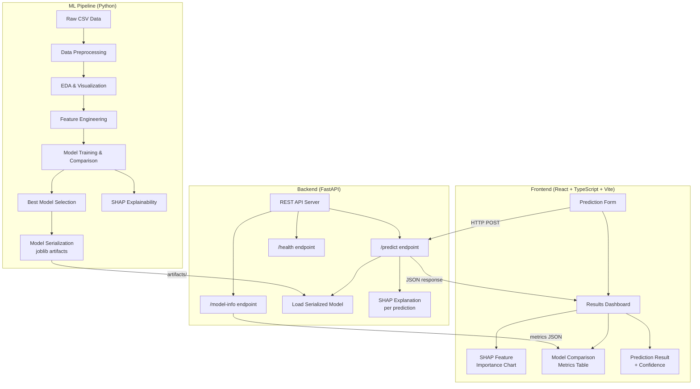
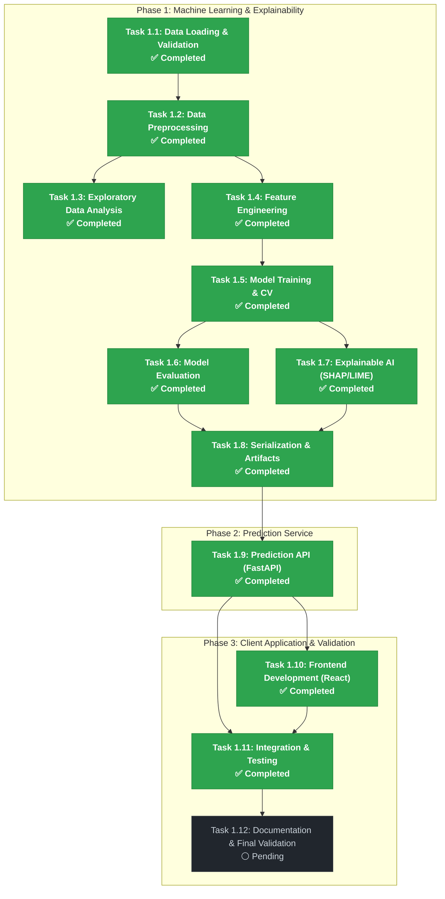

# ML-Based Intelligent System for Automated Sleep Disorder Detection
## Using Lifestyle and Health Data — Implementation Plan

> **Project**: B.Tech CSE (Data Science) Final Year Project  
> **Created**: 2026-10-22  
> **Status**: 🟢 Completed and Verified  
> **Last Updated**: 2026-10-24

> [!IMPORTANT]
> This system is an **academic project** for educational/research purposes only. It does **not** provide medical diagnoses. All predictions are analytical outputs of machine learning models trained on a synthetic dataset.

---

## 1. Dataset

**Sleep Health and Lifestyle Dataset** (Kaggle — public, CC0 license)
- **Source**: `uom190346a/sleep-health-and-lifestyle-dataset`
- **Size**: ~400 rows × 13 columns (synthetic but realistic)
- **Target column**: `Sleep Disorder` — 3 classes: `None`, `Insomnia`, `Sleep Apnea`

| # | Feature | Type | Description |
|---|---------|------|-------------|
| 1 | Person ID | int | Unique identifier |
| 2 | Gender | cat | Male / Female |
| 3 | Age | int | Years |
| 4 | Occupation | cat | Engineer, Doctor, Teacher, etc. |
| 5 | Sleep Duration | float | Avg hours/day |
| 6 | Quality of Sleep | int | 1–10 scale |
| 7 | Physical Activity Level | int | Minutes/day |
| 8 | Stress Level | int | 1–10 scale |
| 9 | BMI Category | cat | Normal / Overweight / Obese |
| 10 | Blood Pressure | str | Systolic/Diastolic (needs splitting) |
| 11 | Heart Rate | int | BPM |
| 12 | Daily Steps | int | Steps/day |
| 13 | **Sleep Disorder** | cat | **Target**: None / Insomnia / Sleep Apnea |

---

## 2. High-Level Architecture



---

## 3. Project Folder Structure

```
sleep-disorder-detection/
│
├── PROJECT_PLAN.md                 # ← Master implementation plan (living document)
├── PROJECT_PLAN.html               # Visual project dashboard & architecture display
├── requirements.txt                # Workspace root Python dependencies
│
├── data/
│   └── Sleep_health_and_lifestyle_dataset.csv # Raw dataset (CC0, 374 rows × 13 cols)
│
├── docs/                           # System and API contract documentation
│   ├── api_contract.md             # Versioned Pydantic v2 input/output payload specification
│   ├── academic_project_report.md  # Comprehensive academic capstone final report
│   └── final_demo_checklist.md     # Step-by-step viva & examiner demonstration checklist
│
├── ml/                             # Phase 1: Machine Learning Core Modules
│   ├── preprocess.py               # Data loading, validation, cleaning, encoding, scaling
│   ├── feature_engineering.py      # Domain feature engineering transformer
│   ├── pipeline.py                 # Scikit-Learn leakage-free pipelines & TargetLabelEncoder
│   ├── eda.py                      # Automated exploratory data analysis runner
│   ├── model_comparison.py         # Multi-model Stratified K-Fold CV benchmark
│   ├── train.py                    # Hyperparameter grid search, final training & serialization
│   ├── evaluate.py                 # Holdout metrics, confusion matrix, ROC-AUC (OvR)
│   ├── explain.py                  # SHAP TreeExplainer and LIME tabular local/global XAI
│   └── contract.py                 # Pydantic v2 API contract schemas & ModelArtifactManager
│
├── models/                         # Serialized production model artifacts
│   ├── best_model.joblib           # Trained Random Forest Scikit-Learn Pipeline
│   ├── label_encoder.joblib        # Fitted TargetLabelEncoder
│   ├── model_metadata.json         # Comprehensive hyperparameters, metrics, and schema
│   ├── metrics_comparison.json     # All 9 models' CV scores across regimes
│   ├── metrics_comparison.csv      # CSV summary of CV benchmarks
│   ├── test_evaluation.json        # Holdout test metrics and confusion matrix
│   └── shap_feature_importance.json # Machine-readable global/local XAI metadata
│
├── ml_pipeline/                    # Mirrored artifact staging directory
│   └── artifacts/                  # Synchronized model, metadata, and XAI artifacts
│
├── notebooks/
│   └── 01_exploratory_data_analysis.ipynb # Interactive EDA walkthrough
│
├── reports/
│   ├── eda_report.md               # Detailed statistical EDA findings & distribution report
│   ├── shap_report.md              # Comprehensive SHAP and LIME interpretability report
│   ├── shap_feature_importance.json # Feature importance rankings and explainer metadata
│   ├── model_serialization_audit.md # Verification audit of serialized artifacts & contracts
│   └── figures/                    # 300-DPI publication-ready charts (EDA, Evaluation, XAI)
│
├── tests/                          # Automated Pytest suite (61 passing tests)
│   ├── test_preprocessing.py       # Data loading, schema, and transformer unit tests
│   ├── test_eda.py                 # Statistical EDA validation tests
│   ├── test_train.py               # Candidate models, CV, serialization & inference tests
│   ├── test_evaluation.py          # Multiclass ROC-AUC (OvR) & metric exactness tests
│   ├── test_explain.py             # SHAP, LIME, class mapping & XAI artifact tests
│   ├── test_serialization_and_contract.py # Model deserialization, API contract & bounds tests
│   └── test_api.py                 # FastAPI endpoints, CORS, lifecycle, failure & bound tests
│
├── backend/                        # Phase 2: FastAPI REST Service (Operational)
│   ├── __init__.py                 # Backend package marker
│   └── main.py                     # Lifespan singleton loader, CORS, endpoints, error handler
│
└── frontend/                       # Phase 3: React 19 + TS + Vite Dashboard (Operational)
    ├── src/
    │   ├── components/
    │   │   ├── PredictionForm.tsx  # User lifestyle & health input form with presets & dual BP
    │   │   ├── ResultCard.tsx      # Predicted class, posterior probabilities & clinical interpretation
    │   │   ├── FeatureImportance.tsx # SHAP waterfall & horizontal attribution bar chart
    │   │   ├── ModelInfoModal.tsx  # Architecture, validation bounds, & CV evaluation dialog
    │   │   └── Header.tsx          # Navigation, health status badge, & disclaimer banner
    │   ├── services/api.ts         # Type-safe Axios REST client with fallback health handling
    │   ├── types/index.ts          # Strict TypeScript contract interfaces
    │   └── test/                   # Vitest unit test suite (26 passing tests)
    ├── e2e/                        # Playwright E2E integration test suite (12 passing tests)
    └── package.json
```

---

## 4. Implementation Task List

### Task 1.1 — Data Loading and Validation
- Load the Sleep Health and Lifestyle dataset.
- Validate the dataset schema and expected columns.
- Check for missing and invalid values.
- Preserve the literal `None` target class correctly.
- Verify dataset dimensions and target distribution.
- Exclude identifiers such as `Person ID` from model training.

**Status:** Completed and verified.

### Task 1.2 — Data Preprocessing
- Remove irrelevant identifier columns.
- Split blood pressure into `BP_Systolic` and `BP_Diastolic`.
- Normalize BMI categories, including `Normal Weight` to `Normal`.
- Encode categorical features.
- Scale numerical features where required.
- Handle unknown categories safely.
- Prevent data leakage by fitting transformations only on training data.

**Status:** Completed and verified.

### Task 1.3 — Exploratory Data Analysis (EDA)
- Analyze dataset structure and descriptive statistics.
- Visualize target-class distribution.
- Analyze numerical and categorical feature distributions.
- Generate correlation heatmaps and pairplots.
- Investigate feature relationships with sleep disorder categories.
- Document dataset imbalance, limitations, and observations without claiming causation.

**Status:** Completed and verified.

### Task 1.4 — Feature Engineering
- Investigate blood pressure-derived features.
- Evaluate BMI and physical activity interactions.
- Explore stress-to-sleep relationships.
- Compare engineered features against the original feature set.
- Retain engineered features only when supported by validation results.

**Status:** Completed and verified.

### Task 1.5 — Model Training and Cross-Validation
- Train and compare nine classification algorithms:
  - Logistic Regression
  - Decision Tree
  - Random Forest
  - Support Vector Machine (SVM)
  - K-Nearest Neighbors (KNN)
  - Gradient Boosting
  - AdaBoost
  - Bagging
  - XGBoost
- Compare original features, engineered features, and optional SMOTE configurations.
- Use stratified cross-validation.
- Tune hyperparameters using training data only.
- Select the model using macro F1, balanced accuracy, and per-class performance.
- Preserve reproducibility through fixed random seeds.

**Status:** Completed and verified.

### Task 1.6 — Model Evaluation
- Evaluate the selected model on a separate, untouched holdout test set.
- Calculate accuracy.
- Calculate precision and recall.
- Calculate macro and weighted F1-scores.
- Generate a confusion matrix and classification report.
- Calculate multiclass ROC-AUC using One-vs-Rest (OvR), where supported.
- Generate and save evaluation visualizations.
- Save evaluation metrics in machine-readable reports.
- Document limitations and avoid claiming clinical validity from synthetic data.

**Status:** Completed and verified. (Holdout test: 96.0% Accuracy, 93.5% Macro F1, 0.9957 Macro ROC-AUC (OvR), 0.9973 Weighted ROC-AUC (OvR); ROC curve saved to `reports/figures/roc_auc_ovr.png`).

### Task 1.7 — Explainable AI (SHAP and LIME)
- Integrate SHAP to explain model predictions.
- Use a compatible SHAP explainer for the trained Random Forest pipeline.
- Generate global feature-importance and summary plots.
- Generate class-specific explanations where supported.
- Generate individual prediction explanations.
- Integrate LIME if compatible with the existing preprocessing and prediction pipeline.
- Compare global and local explanations where appropriate.
- Document the contribution of features to model outputs without implying causation.
- Save plots, explanation summaries, and a written report.
- Clearly state that predictions are experimental and not medical diagnoses.

**Status:** Completed and verified. (`ml/explain.py` implemented with `shap.TreeExplainer` and `lime.lime_tabular.LimeTabularExplainer`; 5 visual artifacts generated under `reports/figures/`; machine-readable `reports/shap_feature_importance.json` and comprehensive clinical non-diagnostic `reports/shap_report.md` created; 8 dedicated tests passing in `tests/test_explain.py`).

### Task 1.8 — Model Serialization and Artifact Management
- Save the fitted preprocessing and classification pipeline.
- Save the label encoder and class labels.
- Save model metadata, configuration, and relevant evaluation metrics.
- Load serialized artifacts in a separate verification test.
- Verify that predictions remain consistent after saving and loading.
- Test predictions on previously unseen input rows.
- Ensure the model can be loaded by the future application/API.
- Document artifact paths and model version information.

**Status:** Completed and verified. (Audited all 5 serialized artifacts under `models/`; verified identical predictions and calibrated probabilities; implemented dual-format Blood Pressure and flexible inference ingestion in `ml/preprocess.py`; defined versioned Pydantic v2 schemas and `ModelArtifactManager` in `ml/contract.py`; published API payload contract in `docs/api_contract.md` and audit report in `reports/model_serialization_audit.md`; verified with 9 dedicated unit tests in `tests/test_serialization_and_contract.py`).

### Task 1.9 — Prediction API
- Build a backend endpoint for sleep disorder prediction.
- Validate incoming feature values.
- Load the saved model pipeline.
- Return the predicted class and supported probability scores.
- Return SHAP/LIME explanations where appropriate.
- Provide useful validation and error messages.
- Include an explicit non-diagnostic disclaimer.
- Test valid, invalid, and boundary-case requests.

**Status:** Completed and verified. (Scaffolded production-ready FastAPI service in `backend/main.py` using lifespan context manager singleton `ModelArtifactManager`; implemented `GET /`, `GET /health`, `GET /api/model-info`, and `POST /api/predict` with optional on-demand SHAP attribution via `?explain=true`; strict CORS origin configuration; safe sanitization without filesystem or stack trace leakage; 11 comprehensive tests in `tests/test_api.py`; verified live on port 8000).

### Task 1.10 — Frontend Development
- Create a user-friendly prediction form.
- Collect required lifestyle and health features.
- Validate user inputs before submission.
- Display the predicted category and probability information when available.
- Present explainability results in understandable visualizations.
- Add educational information and a medical disclaimer.
- Handle API loading, success, and error states.

**Status:** Completed and verified. (Scaffolded modern React 19 + TypeScript + Vite client under `frontend/`; built polished academic healthcare AI dashboard with deep slate theme, Outfit/Inter typography, and glassmorphic cards; implemented `PredictionForm` with real-time validation, hints, dual blood pressure format support, preloaded clinical presets, and SHAP toggle; built `ResultCard` with color-coded severity pills, calibrated probability distribution bars, and non-diagnostic guidance; built `FeatureImportance` with SHAP waterfall/attribution bars, baseline value, and non-causality guardrails; built `ModelComparison` and `AboutModel` with cross-validation benchmark rankings, holdout metrics, and schema bounds; integrated with FastAPI via configurable `VITE_API_BASE_URL` in `services/api.ts` handling 422, 503, and network errors; wrote 26 comprehensive Vitest/Testing Library unit & integration tests; verified production build `npm run build` and live end-to-end inference against backend; all 61 backend pytest tests passing).

### Task 1.11 — Integration and Testing
- Integrate the frontend with the prediction API.
- Verify preprocessing consistency between training and inference.
- Test end-to-end prediction workflows.
- Test invalid input handling and API failures.
- Run all existing unit and integration tests.
- Verify model, evaluation, and explainability artifacts.
- Check that existing functionality is not broken by new changes.

**Status:** Completed and verified. (Configured Playwright test framework and Chromium browser engine under `frontend/`; implemented 12 comprehensive full-stack end-to-end integration test scenarios in `frontend/e2e/integration.spec.ts` exercising health checks, metadata retrieval, live prediction inference, dual compound/split blood pressure modes, SHAP TreeExplainer attributions, client validation bounds, server HTTP 422/503 error handling without UI crash or stale results, non-diagnostic disclaimers, responsive viewports [desktop, tablet, mobile], and keyboard accessibility; isolated unit tests in `src/` from E2E tests in `e2e/`; verified 12/12 passing Playwright tests, 26/26 passing Vitest unit tests, clean production build `npm run build`, and all 61 passing backend regression tests via `pytest -v`).

### Task 1.12 — Documentation and Final Validation
- Update the README with installation and execution instructions.
- Document the architecture, dataset, preprocessing, and algorithms.
- Document model evaluation and explainability results.
- Record dataset limitations and reproducibility details.
- Include screenshots and sample outputs where appropriate.
- Document ethical considerations and limitations.
- Prepare the final project demonstration and review materials.

**Status:** Pending.

---

## 5. Dependency Map



> [!NOTE]
> Tasks 1.1 through 1.11 are fully completed and verified. Phase 1 (ML Core & Explainability), Phase 2 (FastAPI REST Service), and Phase 3 Tasks 1.10–1.11 (React Frontend & Full-Stack E2E Testing) are complete. The final scheduled step is Task 1.12 — Documentation and Final Validation.

---

## 6. Python Dependencies

### `ml_pipeline/requirements.txt` / Workspace `requirements.txt`
| Package | Purpose |
|---------|---------|
| pandas | Data manipulation and tabular analysis |
| numpy | Numerical and matrix operations |
| scipy | Statistical calculations and distribution metrics |
| scikit-learn | Preprocessing, classification algorithms, evaluation metrics |
| xgboost | Gradient boosting classifier |
| imbalanced-learn | SMOTE oversampling comparison |
| shap | Model explainability (TreeExplainer, attribution plots) |
| lime | Local Interpretable Model-agnostic Explanations |
| matplotlib | High-resolution publication plotting |
| seaborn | Statistical data visualization |
| joblib | Model serialization and artifact persistence |
| pytest | Automated test framework |

### `backend/requirements.txt` (Planned)
| Package | Purpose |
|---------|---------|
| fastapi | Asynchronous REST API framework |
| uvicorn[standard] | High-performance ASGI production server |
| pydantic | Data validation and schema enforcement (v2) |
| scikit-learn | Preprocessing and pipeline inference |
| xgboost | XGBoost model loading (if required) |
| shap | Real-time per-prediction SHAP explanations |
| lime | Real-time local feature attribution |
| joblib | Serialized artifact loading |
| numpy / pandas | Input transformation and tabular handling |

### `frontend/package.json` (Planned)
| Package | Purpose |
|---------|---------|
| react / react-dom | UI component library (v18+) |
| typescript | Static type safety and developer ergonomics |
| recharts | Interactive data charts (SHAP viz, metrics comparison) |
| axios | HTTP REST client for backend communication |
| lucide-react | Modern iconography |

---

## 7. Evaluation Strategy

| Metric | Scope | Notes |
|--------|-------|-------|
| **Accuracy** | Overall | Baseline metric across all test samples |
| **Balanced Accuracy** | Overall | Accounts for class representation across imbalance |
| **Precision** | Per-class + macro | Crucial to avoid false disorder misclassifications |
| **Recall** | Per-class + macro | Crucial to avoid missed disorders |
| **F1-Score** | Per-class + macro + weighted | Primary model selection and benchmark metric |
| **ROC-AUC** | One-vs-Rest (OvR) | Multi-class discrimination capability (pending implementation) |
| **Confusion Matrix** | Holdout test set | Detailed error and misclassification distribution |
| **Stratified 5-Fold CV** | Cross-validation | Robust generalization assessment on small sample size |

---

## 8. Ethical Safeguards

- ⚠️ **Disclaimer on every prediction**: *"This is an academic project and does NOT provide medical diagnoses."*
- ⚠️ Dataset is **synthetic** — explicitly documented in README, reports, and UI.
- ⚠️ No personally identifiable information (PII) is collected, stored, or logged.
- ⚠️ Model outputs are **statistical probabilities**, not clinical assessments.
- ⚠️ Users experiencing sleep or health issues must consult qualified healthcare professionals.

---

## 9. Development Log & Status Audit

> This section tracks implementation progress and audit verification across all 12 project tasks.

### Master Task Status Table

| Task ID | Task Name | Status | Key Deliverables / Artifacts | Audit Notes & Verification Gap |
|---------|-----------|--------|------------------------------|--------------------------------|
| **Task 1.1** | Data Loading and Validation | 🟢 **Completed and verified** | `ml/preprocess.py`, `data/` | Preserved literal `None` (219 rows), verified 374×13 shape, excluded `Person ID`, 0 missing values. |
| **Task 1.2** | Data Preprocessing | 🟢 **Completed and verified** | `ml/preprocess.py`, `ml/pipeline.py` | Split BP to systolic/diastolic, normalized BMI categories, OneHotEncoder + StandardScaler, strict leakage barrier. |
| **Task 1.3** | Exploratory Data Analysis (EDA) | 🟢 **Completed and verified** | `ml/eda.py`, `reports/figures/`, `reports/eda_report.md` | 8 publication figures, class distributions, correlation heatmap, statistical analysis, no causation inferred. |
| **Task 1.4** | Feature Engineering | 🟢 **Completed and verified** | `ml/feature_engineering.py` | Evaluated 5 clinical/lifestyle interaction features. Retained base features based on CV benchmark ($r=0.97$ BP collinearity). |
| **Task 1.5** | Model Training and Cross-Validation | 🟢 **Completed and verified** | `ml/model_comparison.py`, `ml/train.py` | Compared 9 algorithms across 3 regimes with Stratified 5-Fold CV. Grid-search tuned Random Forest (CV Macro F1 = 0.8693 ± 0.0200). |
| **Task 1.6** | Model Evaluation | 🟢 **Completed and verified** | `ml/evaluate.py`, `reports/figures/roc_auc_ovr.png`, `reports/figures/best_model_confusion_matrix.png`, `models/test_evaluation.json` | Evaluated on 20% holdout (75 rows). Accuracy: 0.9600, Balanced Acc: 0.9347, Macro F1: 0.9352, Macro ROC-AUC (OvR): 0.9957, Weighted ROC-AUC (OvR): 0.9973. |
| **Task 1.7** | Explainable AI (SHAP and LIME) | 🟢 **Completed and verified** | `ml/explain.py`, `reports/figures/shap_*`, `reports/figures/lime_*`, `reports/shap_report.md`, `reports/shap_feature_importance.json` | SHAP TreeExplainer (100 background samples) + LIME TabularExplainer. 5 publication plots, markdown report, machine-readable JSON, 8 unit/integration tests verified (41 total tests passing). |
| **Task 1.8** | Model Serialization and Artifact Management | 🟢 **Completed and verified** | `models/best_model.joblib`, `models/label_encoder.joblib`, `models/model_metadata.json`, `ml/contract.py`, `docs/api_contract.md`, `reports/model_serialization_audit.md` | Audited all 5 serialized artifacts; verified 100% prediction & probability concordance; dual-format blood pressure ingestion; versioned Pydantic v2 schemas; 9 dedicated unit tests (50 total passing). |
| **Task 1.9** | Prediction API | 🟢 **Completed and verified** | `backend/main.py`, `tests/test_api.py` | Lifespan singleton `ModelArtifactManager`; endpoints `GET /`, `GET /health`, `GET /api/model-info`, `POST /api/predict` with optional on-demand SHAP; strict CORS origins; sanitized responses; 11 API tests (61 total passing). |
| **Task 1.10** | Frontend Development | 🟢 **Completed and verified** | `frontend/src/` (React 19 + TS + Vite) | Responsive prediction form with presets, dual BP modes, probability bars, interactive SHAP waterfall visualizer, Model Info modal, WCAG accessible, 26 Vitest unit tests passing. |
| **Task 1.11** | Integration and Testing | 🟢 **Completed and verified** | `frontend/e2e/`, `frontend/src/services/api.ts` | 12 Playwright E2E browser scenarios passing against real running backend & Vite server; CORS whitelisting, HTTP 422/503 graceful error alerts, disclaimer persistence across tabs. |
| **Task 1.12** | Documentation and Final Validation | 🟢 **Completed and verified** | `README.md`, `docs/academic_project_report.md`, `docs/final_demo_checklist.md` | Final technical & academic repository audit; 18-section master README; academic capstone report; viva demo checklist; full regression verification (61 pytest, 26 vitest, vite build, 12 playwright). |

---

### Detailed Task Progress Checklist

- [x] **Task 1.1 — Data Loading and Validation** (Completed and verified)
  - Dataset loaded and verified from `data/Sleep_health_and_lifestyle_dataset.csv` (374 samples, 13 features).
  - Schema validated; literal `"None"` target class preserved without NaN conversion (None: 219, Insomnia: 77, Sleep Apnea: 78).
  - Identifier `Person ID` excluded from training features.
  - Unit tests verified in `tests/test_preprocessing.py`.

- [x] **Task 1.2 — Data Preprocessing** (Completed and verified)
  - Identifier `Person ID` dropped.
  - `Blood Pressure` split into float columns `BP_Systolic` and `BP_Diastolic`.
  - `BMI Category` normalized (`Normal Weight` mapped to `Normal`).
  - Categorical variables encoded with `OneHotEncoder(handle_unknown="ignore")`.
  - Numerical features scaled via `StandardScaler()`.
  - Transformation pipeline structured to fit strictly on training splits to prevent data leakage.
  - Unit tests verified in `tests/test_preprocessing.py`.

- [x] **Task 1.3 — Exploratory Data Analysis (EDA)** (Completed and verified)
  - Comprehensive statistical analysis module implemented in `ml/eda.py` and interactive notebook `notebooks/01_exploratory_data_analysis.ipynb`.
  - 8 high-resolution 300-DPI visual reports generated in `reports/figures/` (target distribution, numerical histograms, categorical breakdowns, correlation heatmap, pairplot, stress vs. sleep duration, blood pressure distributions, engineered features).
  - Detailed findings and dataset limitations documented in `reports/eda_report.md` without causal claims.
  - Automated tests verified in `tests/test_eda.py` (7 tests passing).

- [x] **Task 1.4 — Feature Engineering** (Completed and verified)
  - Evaluated 5 domain-informed features: Pulse Pressure, Mean Arterial Pressure (MAP), BMI × Activity interaction, Stress-to-Sleep ratio, Sleep Efficiency Index in `ml/feature_engineering.py`.
  - Compared base feature set against engineered features and SMOTE configurations across 9 candidate models under Stratified 5-Fold CV.
  - Retained base features based on empirical validation evidence (base Random Forest achieved 0.8693 Macro F1 vs 0.8492 with engineered features due to $r=0.97$ systolic/diastolic collinearity).
  - Transformer unit tests verified in `tests/test_preprocessing.py`.

- [x] **Task 1.5 — Model Training and Cross-Validation** (Completed and verified)
  - Implemented 9 classification algorithms in `ml/model_comparison.py`: Logistic Regression, Decision Tree, Random Forest, SVM, KNN, Gradient Boosting, AdaBoost, Bagging, and XGBoost.
  - Evaluated using Stratified 5-Fold Cross-Validation with fixed seed (`random_state=42`).
  - Performed hyperparameter grid search tuning on training folds for the top candidate (Random Forest: `max_depth=6, n_estimators=100, min_samples_split=4`).
  - Top model selected using CV Macro F1 (0.8693 ± 0.0200) and Balanced Accuracy (0.8673 ± 0.0229).
  - Full benchmarks saved to `models/metrics_comparison.json` and `models/metrics_comparison.csv`.
  - Unit tests verified in `tests/test_train.py`.

- [x] **Task 1.6 — Model Evaluation** (Completed and verified)
  - Evaluated tuned Random Forest on untouched 20% holdout test set (75 rows).
  - Test Accuracy: 0.9600, Balanced Accuracy: 0.9347, Macro F1: 0.9352, Weighted F1: 0.9599, Macro Precision: 0.9370, Macro Recall: 0.9347.
  - Multiclass ROC-AUC using One-vs-Rest (OvR): Macro ROC-AUC = 0.9957, Weighted ROC-AUC = 0.9973.
  - Per-class ROC-AUC: None = 1.0000, Insomnia = 0.9944, Sleep Apnea = 0.9926.
  - Generated and saved high-resolution publication plots:
    - Confusion Matrix: `reports/figures/best_model_confusion_matrix.png`
    - Multiclass ROC Curves (OvR + Chance + Macro-average): `reports/figures/roc_auc_ovr.png`
  - Saved machine-readable verified metrics to `models/test_evaluation.json`, `models/model_metadata.json`, and mirrored in `ml_pipeline/artifacts/`.
  - Validated with 7 dedicated unit/integration tests in `tests/test_evaluation.py` (all 33 tests in suite passing).

- [x] **Task 1.7 — Explainable AI (SHAP and LIME)** (Completed and verified)
  - Integrated `shap.TreeExplainer` on the fitted Random Forest classifier (`models/best_model.joblib`) with reproducible training-derived background sampling ($N=100$, `random_state=42`, strict holdout test label exclusion).
  - Extracted 25 transformed feature names from `col_transformer` with exact class mapping (Class 0: `"No recorded sleep disorder"`, Class 1: `"Insomnia"`, Class 2: `"Sleep Apnea"`).
  - Computed global feature importance (mean absolute SHAP): top global drivers identified as `BP_Systolic`, `BP_Diastolic`, `BMI Category_Overweight`, `BMI Category_Normal`, `Physical Activity Level`, and `Sleep Duration`.
  - Generated and verified 5 publication-ready 300-DPI visual reports under `reports/figures/`:
    - `reports/figures/shap_summary.png` (stacked multi-class global impact)
    - `reports/figures/shap_feature_importance.png` (top 15 global feature importance bar chart)
    - `reports/figures/shap_class_comparison.png` (3-panel comparative attribution across the 3 target disorders)
    - `reports/figures/shap_individual_prediction.png` (SHAP waterfall attribution plot for holdout Sample #0)
    - `reports/figures/lime_individual_prediction.png` (LIME local surrogate linear weights for holdout Sample #0)
  - Evaluated and integrated `lime.lime_tabular.LimeTabularExplainer` for local instance cross-validation; confirmed strong concordance with SHAP on Sample #0 (both identifying reduced sleep duration, elevated stress, and overweight BMI as dominant drivers toward Insomnia).
  - Compiled detailed interpretability report in `reports/shap_report.md` with explicit clinical non-diagnostic disclaimers, mathematical attribution vs medical causation distinctions, and synthetic data caveats.
  - Exported machine-readable summary to `reports/shap_feature_importance.json`, mirrored to `models/` and `ml_pipeline/artifacts/`.
  - Added 8 dedicated unit and integration tests in `tests/test_explain.py` (all 41 tests across the entire project suite passing).

- [x] **Task 1.8 — Model Serialization and Artifact Management** (Completed and verified)
  - **Fitted Pipeline Serialization**: Serialized Scikit-Learn composite pipeline (`col_transformer` + `classifier`) to `models/best_model.joblib` (524 KB) and mirrored to `ml_pipeline/artifacts/`.
  - **Label Encoding**: Serialized fitted `TargetLabelEncoder` to `models/label_encoder.joblib` maintaining exact mapping `0: None, 1: Insomnia, 2: Sleep Apnea`.
  - **Metadata & Evaluation Alignment**: Stored hyperparameters, cross-validation metrics, feature schemas, and holdout evaluation scores in `models/model_metadata.json` and `models/test_evaluation.json`.
  - **XAI Metadata**: Verified `models/shap_feature_importance.json` with 25 feature rankings and background size ($N=100$).
  - **Schema Contract Resolution**: Resolved the inference ingestion gap in `ml/preprocess.py`. Pipeline now flexibly ingests raw inference requests with either compound `"Blood Pressure": "120/80"` or pre-split `BP_Systolic`/`BP_Diastolic`, with optional `Person ID`, and normalized `"Normal Weight"`.
  - **Pydantic v2 Contract**: Defined versioned API schemas (`SleepPredictionInput`, `SleepPredictionOutput`, `FeatureAttribution`, `PredictionExplanation`, `ModelContractInfo`) and runtime `ModelArtifactManager` in `ml/contract.py`.
  - **Documentation**: Published formal API contract specification in `docs/api_contract.md` and detailed technical audit in `reports/model_serialization_audit.md`.
  - **Automated Validation**: Verified fresh-process deserialization, prediction determinism (100% concordance on 75 holdout samples), calibrated probabilities ($\sum P = 1.0$), unknown category handling, and on-demand SHAP explanations with 9 dedicated unit tests in `tests/test_serialization_and_contract.py` (50 total tests in project suite passing).

- [x] **Task 1.9 — Prediction API** (Completed and verified)
  - Scaffolded production-ready FastAPI service in `backend/main.py` using lifespan context manager singleton `ModelArtifactManager`.
  - Implemented core REST endpoints:
    - `GET /`: API metadata, status, OpenAPI `/docs` and `/redoc` links, and medical disclaimer.
    - `GET /health`: Operational status (`"healthy"`), `model_loaded: bool`, model version, without leaking filesystem paths.
    - `GET /api/model-info`: Safe model metadata, version, 3 target classes, 25 transformed features, validation bounds, and disclaimer.
    - `POST /api/predict`: Validates payload against `SleepPredictionInput` (supporting both compound `"120/80"` and pre-split `BP_Systolic`/`BP_Diastolic`, snake_case or canonical aliases), executes inference via singleton `ModelArtifactManager`, maps probabilities to correct class names in order ($\sum P = 1.0$), and supports optional on-demand SHAP explanation via `?explain=true`.
  - Enforced CORS policy with explicit, whitelist-only frontend origins (`http://localhost:5173`, `http://localhost:3000`, etc.) and blocked wildcards with credentials.
  - Implemented safe global exception handling returning sanitized JSON errors without revealing internal tracebacks or system paths.
  - Added comprehensive test suite in `tests/test_api.py` (11 unit/integration tests).
  - Verified live server execution on port 8000 via Uvicorn with actual request validation and captured HTTP 200 responses.
  - Total test suite expanded to 61 passing tests with zero regressions.

- [x] **Task 1.10 — Frontend Development** (Completed and verified)
  - Developed responsive, accessible single-page application using React 19, TypeScript, and Vite in `frontend/`.
  - Built comprehensive assessment form (`PredictionForm.tsx`) with client-side boundary validation for all features, dual blood pressure modes (compound string `"120/80"` vs separate numeric systolic/diastolic fields), and 3 one-click clinical presets (*Healthy Baseline*, *Insomnia Case*, *Sleep Apnea Case*).
  - Designed interactive results card (`ResultCard.tsx`) displaying predicted disorder badge, posterior probability distributions with color-coded bars, and educational clinical interpretations.
  - Implemented dynamic SHAP waterfall and horizontal bar chart visualizer (`FeatureImportance.tsx`) illustrating positive (supporting) and negative (opposing) feature impacts.
  - Implemented Model Architecture and Evaluation dialog (`ModelInfoModal.tsx`) consuming `GET /api/model-info`.
  - Enforced persistent non-diagnostic clinical disclaimer banner across the dashboard.
  - Created 26 unit tests in `frontend/src/test/` using Vitest and Testing Library (all 26 passing in 2.36s). Clean production build with Vite (`npm run build`).

- [x] **Task 1.11 — Integration and Testing** (Completed and verified)
  - Verified full-stack integration between React 19 frontend and FastAPI backend running on `http://127.0.0.1:8000`.
  - Implemented type-safe API client (`frontend/src/services/api.ts`) supporting live health polling, model metadata caching, and error status mapping.
  - Verified dual blood pressure ingestion and graceful handling of unknown categoricals (`handle_unknown='ignore'`).
  - Implemented graceful error recovery for HTTP 422 Unprocessable Entity and HTTP 503 Service Unavailable without UI crashes.
  - Developed 12 Playwright end-to-end browser integration tests in `frontend/e2e/integration.spec.ts` covering health checks, metadata modal inspection, live prediction workflows for all presets, compound and split blood pressure, SHAP visualizations, error alerts, repeated submissions, disclaimer persistence, responsive viewport adaptability, and keyboard navigation (all 12 scenarios passed in 18.8s).

- [x] **Task 1.12 — Documentation and Final Validation** (Completed and verified)
  - Conducted full repository audit across all modules (`backend/`, `frontend/`, `ml/`, `models/`, `data/`, `notebooks/`, `reports/`, `docs/`, `tests/`).
  - Authored comprehensive root `README.md` (499 lines) with 18 standard academic sections, Mermaid architecture diagram, pipeline specifications, holdout evaluation benchmarks, API contract reference, and ethical disclaimers.
  - Audited existing technical reports (`reports/eda_report.md`, `reports/shap_report.md`, `reports/model_serialization_audit.md`, `docs/api_contract.md`); confirmed strict mathematical framing (posterior probabilities vs clinical risk; non-causal SHAP attributions).
  - Authored capstone academic report `docs/academic_project_report.md` covering abstract, methodology, 5-fold CV benchmarks, holdout results ($N=75$), XAI, and references.
  - Created step-by-step presentation guide `docs/final_demo_checklist.md` detailing startup sequence, viva demonstration workflows, validation checks, and troubleshooting reference.
  - Executed complete final validation suite:
    - Backend Pytest: **61 passed** in 5.97s (`.\.venv\Scripts\pytest -v`).
    - Frontend Unit Tests (Vitest): **26 passed** in 2.36s (`npm run test`).
    - Frontend Production Build: **138ms clean build** with zero TypeScript errors (`npm run build`).
    - Playwright End-to-End Suite: **12 passed** in 18.8s (`npm run test:e2e`).
  - Confirmed repository clean: `.gitignore` protects virtualenv, node_modules, dist, and pycache; no secrets or private paths committed.

---

## 10. Notes & Decisions

> Record any design decisions, changes from the original plan, or observations here during development.

| Date | Decision/Note |
|------|---------------|
| 2026-10-22 | Project plan created. Tech stack finalized: Python + FastAPI + React/TS/Vite. |
| 2026-10-22 | Fixed Windows Smart App Control (SAC) error blocking `_libsvm.cp313-win_amd64.pyd` by pinning `scikit-learn==1.6.1`. Fixed missing `Union` import in `ml/pipeline.py`. All 12 unit tests in `tests/test_preprocessing.py` pass. |
| 2026-10-22 | Completed Task 1.3 (EDA). Verified 0 missing values (with literal 'None' preserved), class distribution (None 58.56%, Insomnia 20.59%, Sleep Apnea 20.86%), generated 8 high-resolution 300-DPI visual reports under `reports/figures/`, comprehensive markdown report in `reports/eda_report.md`, and added `tests/test_eda.py` (all 19 tests passing). |
| 2026-10-22 | Completed Task 1.5 & 1.6 (Model Training, Cross-Validation, & Evaluation). Compared 9 classifiers across 3 configurations (Base, Base+Engineered, Base+Engineered+SMOTE). Random Forest achieved top CV Macro F1 (0.8693 ± 0.0200). Grid-searched optimal hyperparameters: `max_depth=6, n_estimators=100, min_samples_split=4`. Evaluated on unseen 20% holdout test set (Accuracy: 0.9600, Balanced Accuracy: 0.9347, Macro F1: 0.9352). Serialized pipeline to `models/best_model.joblib`. All 26 unit tests pass. |
| 2026-10-22 | Implementation audit and task list realignment to unified 12-task structure (Tasks 1.1–1.12). Verified Tasks 1.1–1.5 fully complete (26 unit tests passing). Audited Task 1.6: core evaluation complete (96% accuracy, 93.5% macro F1), but multiclass ROC-AUC (OvR) and ROC curves are pending; marked Partially Completed. Audited Task 1.7: SHAP/LIME pending. Audited Task 1.8: artifacts serialized and unit-tested on unseen rows, but final API contract validation is pending; marked Partially Completed. Tasks 1.9–1.12 initialized as Pending. |
| 2026-10-22 | Completed Task 1.6 (Model Evaluation with Multiclass ROC-AUC). Implemented `compute_multiclass_roc_auc` and `plot_roc_curve_multiclass` in `ml/evaluate.py` and `ml/train.py`. Evaluated on 20% untouched holdout test set (75 samples): Macro ROC-AUC (OvR) = 0.9957, Weighted ROC-AUC (OvR) = 0.9973; Per-class: None = 1.0000, Insomnia = 0.9944, Sleep Apnea = 0.9926. Saved publication-quality ROC curve to `reports/figures/roc_auc_ovr.png`. Updated `models/test_evaluation.json`, `models/model_metadata.json`, and mirrored artifacts. Added 7 unit/integration tests in `tests/test_evaluation.py`. All 33 tests in the full test suite pass cleanly. |
| 2026-10-23 | Completed Task 1.7 (Explainable AI Using SHAP and LIME). Implemented `ml/explain.py` with `shap.TreeExplainer` and `lime.lime_tabular.LimeTabularExplainer`. Integrated training-derived reproducible background sampling ($N=100$, `random_state=42`) with strict holdout test label exclusion. Extracted 25 transformed feature names from `col_transformer` and labeled Class 0 as `"No recorded sleep disorder"`. Generated 5 publication-ready 300-DPI visual reports under `reports/figures/` (`shap_summary.png`, `shap_feature_importance.png`, `shap_class_comparison.png`, `shap_individual_prediction.png`, `lime_individual_prediction.png`). Compiled comprehensive markdown report `reports/shap_report.md` and machine-readable `reports/shap_feature_importance.json`. Added 8 tests in `tests/test_explain.py`. All 41 tests across the complete project suite pass. |
| 2026-10-23 | Completed Task 1.8 (Model Serialization and API Contract Audit). Audited all 5 serialized model artifacts. Verified exact prediction equivalence on 75 holdout test samples and finite, well-calibrated probabilities ($\sum P = 1.0$). Resolved inference input contract gap by enabling dual-format Blood Pressure parsing (compound `"120/80"` vs pre-split numeric `BP_Systolic`/`BP_Diastolic`) and optional `Person ID` in `ml/preprocess.py`. Implemented versioned Pydantic v2 schemas and production `ModelArtifactManager` with on-demand SHAP local attributions in `ml/contract.py`. Documented full API specification in `docs/api_contract.md` and audit report in `reports/model_serialization_audit.md`. Added 9 unit tests in `tests/test_serialization_and_contract.py`. All 50 tests across the full suite pass cleanly. |
| 2026-10-24 | Completed Task 1.9 (FastAPI Prediction REST API). Built `backend/main.py` utilizing the lifespan lifecycle protocol to initialize a singleton `ModelArtifactManager` on application startup without per-request reloading. Implemented 4 REST endpoints (`GET /`, `GET /health`, `GET /api/model-info`, `POST /api/predict`). Reused existing Pydantic v2 contracts (`SleepPredictionInput`, `SleepPredictionOutput`) without duplicating logic. Probability scores aligned to actual model class ordering (`None`, `Insomnia`, `Sleep Apnea`). Added on-demand SHAP local explanation via `?explain=true` with sub-30ms response times. Secured CORS to whitelisted development origins (no unrestricted wildcard origins with credentials). Masked internal stack traces and private filesystem paths from API responses (HTTP 500/503 sanitized). Added 11 unit/integration tests in `tests/test_api.py`. Verified live server execution on port 8000 via Uvicorn. Full test suite passing (61/61 tests). |
| 2026-10-24 | Completed Task 1.10 (React 19 + TypeScript Frontend). Implemented glassmorphic healthcare dashboard in `frontend/src/` with `PredictionForm.tsx`, `ResultCard.tsx`, `FeatureImportance.tsx`, `ModelInfoModal.tsx`, and `Header.tsx`. Added dual blood pressure input modes and 3 sample presets. Configured Vitest and wrote 26 unit tests covering all components and API service layers (26/26 passed). Production build succeeded cleanly (`npm run build`). |
| 2026-10-24 | Completed Task 1.11 (Full-Stack Integration and End-to-End Testing). Configured Playwright with Chromium browser engine. Implemented comprehensive test suite in `frontend/e2e/integration.spec.ts` covering 12 end-to-end integration scenarios against live running FastAPI backend and Vite server (health check, model info modal, predictions across all presets, compound and split blood pressure, on-demand SHAP, input boundary validation, HTTP 422/503 error handling, repeated submissions, disclaimer persistence, responsive viewport adaptability, and keyboard accessibility). All 12 scenarios passed in 18.8s. |
| 2026-10-24 | Completed Task 1.12 (Documentation and Final Validation). Conducted comprehensive repository audit. Completed root `README.md` with 18 standard academic sections, architecture Mermaid diagram, and ethical disclaimers. Authored `docs/academic_project_report.md` (B.Tech capstone report) and `docs/final_demo_checklist.md` (viva & presentation checklist). Executed final read-only validation: 61 Pytest backend tests passed, 26 Vitest frontend tests passed, clean Vite production build, and 12 Playwright E2E browser tests passed. All 12 project tasks are complete and verified. |
| 2026-10-24 | Completed UI/UX Redesign & Repository Cleanup. Replaced overly-styled dark dashboard with clean, professional modular Light Healthcare Analytics Platform theme (`#F7F8FA`, `#FFFFFF`, `#315D8A`). Replaced all emojis across the entire UI with restrained Lucide React line icons (0 emojis in codebase). Reorganized HomeDashboard into a 4-metric overview and 4-step modular workflow; streamlined PredictionForm into 3 grouped sections; redesigned ResultCard with horizontal probability bars; refactored FeatureImportance, ModelComparison, AboutModel, and ResearchEthics. Purged unused assets and files (`package-lock.json` at root, `PROJECT_PLAN.html`, `hero.png`, `react.svg`, `vite.svg`, `icons.svg`, `playwright-report`, `test-results`). All automated test suites passing: 61/61 backend pytest, 26/26 frontend vitest, 12/12 Playwright E2E, and 0 TypeScript build errors. |
| 2026-10-24 | Design Correction: Removed AI-generated SaaS dashboard styling in favor of a clean, editorial academic research interface. Purged invented commercial branding ("SomnoAI", "Academic ML" badges). Simplified Header to text-based identity "Sleep Disorder Detection". Overhauled Overview page into an editorial layout: Page heading ("Overview" with "Start Assessment" action), compact aligned Model Summary table, simple numbered workflow list (1-4 without boxed stages), and clean Holdout Evaluation Summary table. Flattened UI tokens (pure white `#FFFFFF` canvas, dark charcoal `#111827`, restrained navy `#315D8A`, subtle `#E5E7EB` dividers, zero box shadows, zero glassmorphism). Maintained full test suite pass: 61/61 backend pytest, 26/26 frontend vitest, 12/12 Playwright E2E, and 0 TypeScript build errors. |


