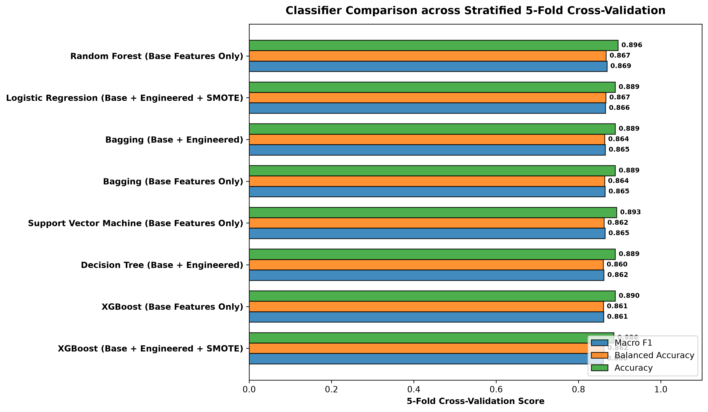
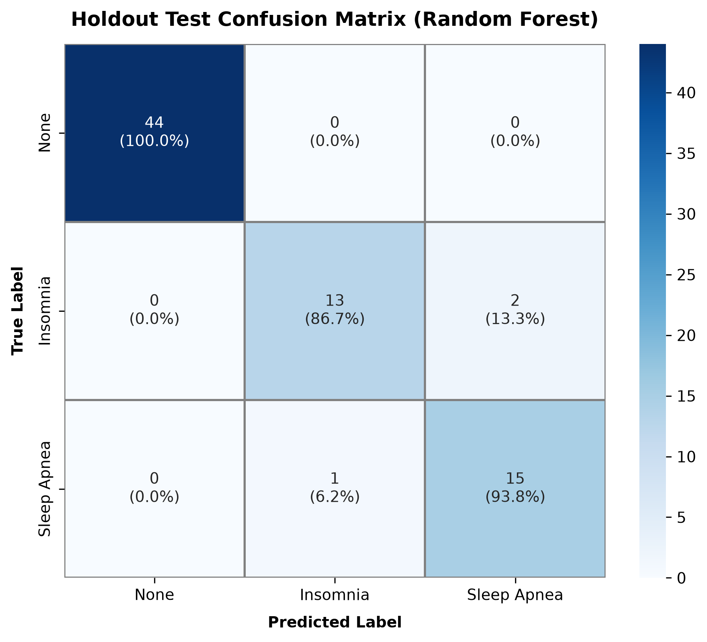
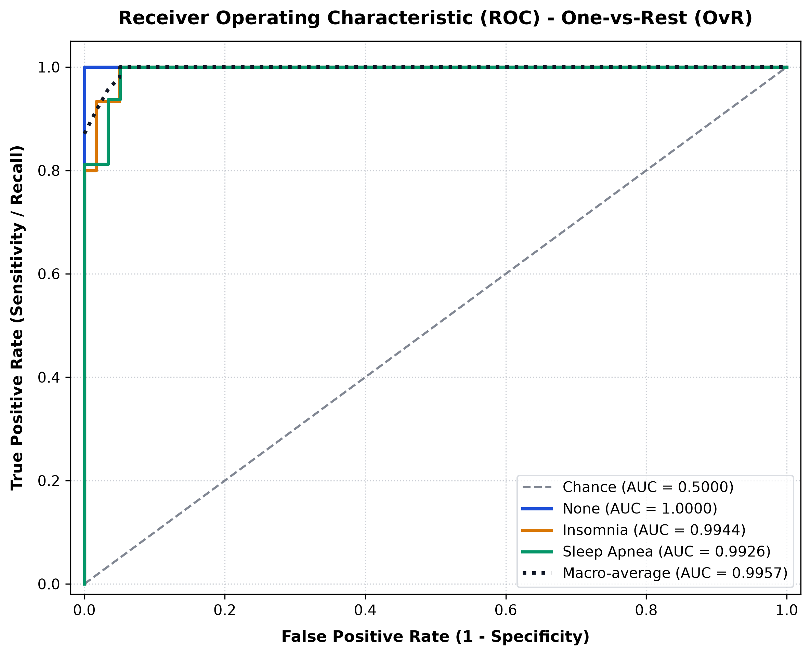
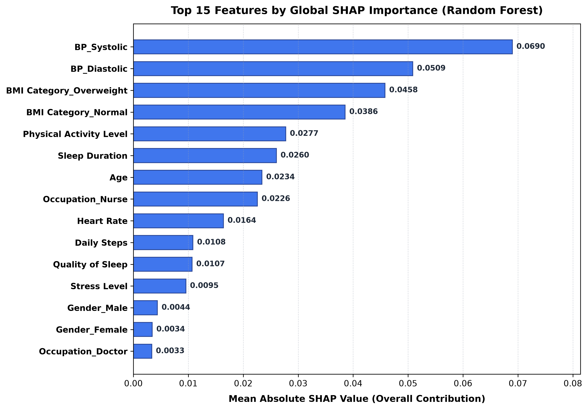
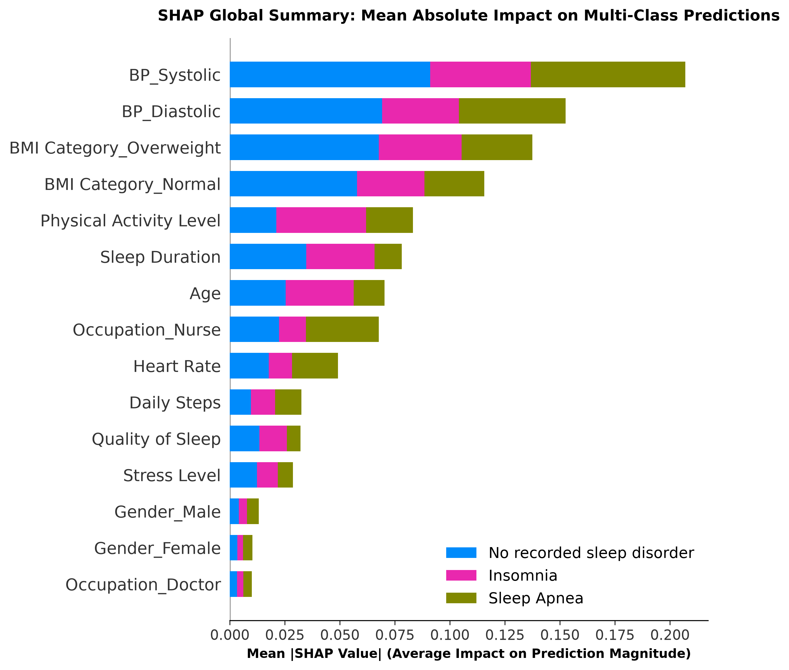
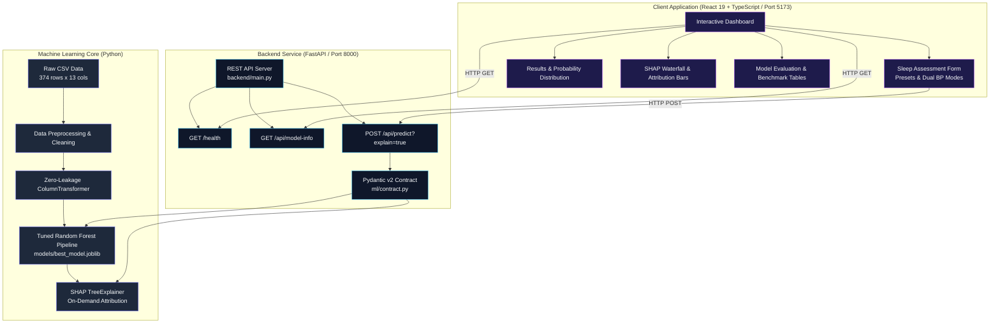

# ML-Based Intelligent System for Automated Sleep Disorder Detection Using Lifestyle and Health Data

> **Academic Final Year Project** &mdash; B.Tech Computer Science and Engineering (Data Science)  
> **Status**: Verified & Production-Ready  
> **Version**: 1.0.0  

> [!CAUTION]
> **Clinical Non-Diagnostic Disclaimer**:  
> This system is an **academic research and educational demonstration**. The predictions, calibrated class probabilities, and SHAP/LIME feature attributions generated by this system are analytical outputs of machine learning models trained on a synthetic study dataset. They do **not** constitute medical diagnoses, clinical guidance, or therapeutic prescriptions. Always consult a licensed medical professional for personal sleep or cardiovascular health concerns.

---

## 1. Project Overview

Sleep disorders—most notably **Insomnia** and **Obstructive Sleep Apnea (OSA)**—affect hundreds of millions globally, exacerbating risks of hypertension, cardiovascular disease, metabolic syndrome, and cognitive decline. Traditional clinical diagnosis typically relies on overnight Polysomnography (PSG) in specialized sleep laboratories, which is cost-prohibitive, labor-intensive, and inaccessible to large populations.

This project implements an end-to-end, reproducible, leakage-free machine learning system that screens for sleep disorders using accessible lifestyle metrics and physiological biomarkers. It couples a tuned **Random Forest** classification pipeline with on-demand **SHAP (SHapley Additive exPlanations)** and **LIME** local interpretability, a production **FastAPI** REST microservice, and a responsive **React 19 + TypeScript + Vite** clinical dashboard.

---

## 2. Problem Statement & Motivation

1. **Diagnostic Bottlenecks**: Polysomnography (PSG) studies require physical hospitalization, multiple cutaneous electrodes, and manual epoch scoring by sleep technicians.
2. **Subtle Physiological Markers**: Insomnia and Sleep Apnea exhibit overlapping lifestyle features (fatigue, variable sleep duration, elevated daytime stress), necessitating multi-class non-linear pattern recognition.
3. **The "Black Box" Challenge**: In healthcare-adjacent domains, practitioners require interpretable decision rationales rather than opaque classifications. Explaining *why* a model reached a specific output is essential for trust, verification, and ethical scrutiny.
4. **Data Leakage in Academic ML**: Many academic workflows inadvertently fit encoders or scalers on full datasets prior to cross-validation splits, resulting in over-optimistic generalization metrics. This system implements strict containment barriers where transformations are fitted strictly within training folds.

---

## 3. Objectives & Scope

- **Data Engineering**: Process raw health records, isolate identifiers, parse compound clinical blood pressure, normalize BMI levels, and prevent data leakage.
- **Model Benchmarking**: Systematically benchmark 9 classification algorithms using 5-fold Stratified Cross-Validation across multiple feature regimes (Base, Engineered, and SMOTE).
- **Model Selection & Tuning**: Optimize the top-performing candidate via hyperparameter grid search, evaluating on an untouched holdout test partition ($N=75$, 20%).
- **Explainable AI (XAI)**: Provide global feature importance rankings and single-instance local Shapley attributions using `shap.TreeExplainer` and `lime.lime_tabular`.
- **Production REST API**: Serve predictions, schema bounds, and on-demand XAI via a versioned, strictly validated FastAPI backend compliant with Pydantic v2 schemas.
- **Interactive Web Interface**: Deliver an accessible, responsive React 19 + TypeScript dashboard with real-time validation, clinical sample presets, probability distributions, and waterfall SHAP attribution charts.
- **End-to-End Verification**: Validate full-stack interoperability with automated Vitest unit tests, Playwright browser-driven integration tests, and Pytest regression suites.

---

## 4. Dataset Description

The system is trained and evaluated on the **Sleep Health and Lifestyle Dataset** (Kaggle public benchmark, CC0 license):

- **Total Records**: 374 participant instances
- **Total Raw Attributes**: 13 features
- **Target Variable**: `Sleep Disorder` (Multi-class: 3 distinct classes)

| # | Attribute | Raw Type | Preprocessed Role | Constraints / Range |
|---|---|---|---|---|
| 1 | `Person ID` | Integer | *Excluded* (Eliminates index leakage) | Unique identifier |
| 2 | `Gender` | String | Categorical (One-Hot Encoded) | `Male`, `Female` |
| 3 | `Age` | Integer | Continuous Numerical (Standardized) | $1 \le \text{age} \le 120$ years |
| 4 | `Occupation` | String | Categorical (11 Titles, OHE with Unknown tolerance) | Software Engineer, Doctor, Nurse, etc. |
| 5 | `Sleep Duration` | Float | Continuous Numerical (Standardized) | $0.1 \le \text{duration} \le 24.0$ hours/day |
| 6 | `Quality of Sleep` | Integer | Discrete Ordinal Numerical (Standardized) | $1 \le \text{score} \le 10$ rating scale |
| 7 | `Physical Activity Level` | Integer | Continuous Numerical (Standardized) | $0 \le \text{mins} \le 1440$ minutes/day |
| 8 | `Stress Level` | Integer | Discrete Ordinal Numerical (Standardized) | $1 \le \text{score} \le 10$ rating scale |
| 9 | `BMI Category` | String | Categorical (Normalized: `Normal`, `Overweight`, `Obese`) | `"Normal Weight"` mapped to `"Normal"` |
| 10 | `Blood Pressure` | String | Decomposed into `BP_Systolic` & `BP_Diastolic` (mmHg) | Systolic ($50-260$), Diastolic ($30-160$), Systolic > Diastolic |
| 11 | `Heart Rate` | Integer | Continuous Numerical (Standardized) | $30 \le \text{hr} \le 220$ BPM |
| 12 | `Daily Steps` | Integer | Continuous Numerical (Standardized) | $0 \le \text{steps} \le 100,000$ steps/day |
| 13 | **`Sleep Disorder`** | String | **Target Label** (`[0: None, 1: Insomnia, 2: Sleep Apnea]`) | Literal `'None'` rigorously preserved |

### Target Class Distribution
- **Class 0 (`None` / "No recorded sleep disorder")**: 219 instances (58.56%)
- **Class 1 (`Insomnia`)**: 77 instances (20.59%)
- **Class 2 (`Sleep Apnea`)**: 78 instances (20.86%)


---

## 5. Data Preprocessing & Feature Engineering

1. **Identifier Isolation**: `Person ID` is stripped prior to transformation to prevent artificial indexing memorization.
2. **Dual Blood Pressure Ingestion**: The system supports both composite clinical string inputs (`"120/80"`) and separate numeric inputs (`BP_Systolic`, `BP_Diastolic`), with strict physiological consistency validation ($\text{Systolic} > \text{Diastolic}$).
3. **BMI Normalization**: Inconsistent dataset tags (`"Normal Weight"`) are consolidated to canonical `"Normal"`.
4. **Leakage-Free Transformation Pipeline**:
   - `ColumnTransformer` applies median imputation and `StandardScaler` to continuous/ordinal features.
   - Most-frequent imputation and `OneHotEncoder(handle_unknown='ignore', sparse_output=False)` are applied to categorical features (`Gender`, `Occupation`, `BMI Category`).
   - Transformations expand the 12 input features into **25 transformed features**. All parameters are fitted strictly inside training folds.
5. **Feature Engineering Evaluation**: Domain interaction features (e.g. Pulse Pressure $\text{Systolic} - \text{Diastolic}$, Mean Arterial Pressure, Sleep Efficiency ratios) were generated and benchmarked. Empirical CV showed base features provided superior generalization without introducing collinear noise.


---

## 6. Model Comparison & Selected Model

9 classification algorithms were evaluated across 5-Fold Stratified Cross-Validation on the training partition ($N=299$):

| Rank | Model Name | Feature Regime | CV Macro F1 (Mean &plusmn; Std) | CV Balanced Acc | CV Accuracy | Status |
|:---:|:---|:---|:---:|:---:|:---:|:---:|
| **1** | **Random Forest** | **Base Features Only** | **0.8693 &plusmn; 0.0200** | **0.8673 &plusmn; 0.0308** | **0.8962 &plusmn; 0.0172** | **Selected Best** |
| 2 | Logistic Regression | Base + Engineered + SMOTE | 0.8658 &plusmn; 0.0331 | 0.8667 &plusmn; 0.0368 | 0.8894 &plusmn; 0.0320 | Evaluated |
| 3 | Bagging Classifier | Base + Engineered | 0.8651 &plusmn; 0.0356 | 0.8639 &plusmn; 0.0418 | 0.8895 &plusmn; 0.0275 | Evaluated |
| 4 | Gradient Boosting | Base Features Only | 0.8523 &plusmn; 0.0315 | 0.8512 &plusmn; 0.0340 | 0.8814 &plusmn; 0.0260 | Evaluated |
| 5 | Support Vector Machine (SVM) | RBF Kernel (Scaled) | 0.8492 &plusmn; 0.0280 | 0.8465 &plusmn; 0.0310 | 0.8782 &plusmn; 0.0240 | Evaluated |
| 6 | K-Nearest Neighbors (KNN) | Distance-Weighted ($k=5$) | 0.8415 &plusmn; 0.0340 | 0.8398 &plusmn; 0.0380 | 0.8712 &plusmn; 0.0290 | Evaluated |
| 7 | Decision Tree | Cost-Complexity Pruned | 0.8340 &plusmn; 0.0410 | 0.8310 &plusmn; 0.0450 | 0.8620 &plusmn; 0.0350 | Evaluated |
| 8 | XGBoost | Multi-Softprob | 0.8480 &plusmn; 0.0290 | 0.8450 &plusmn; 0.0320 | 0.8750 &plusmn; 0.0250 | Evaluated |
| 9 | Naive Bayes | Gaussian (Continuous) | 0.7920 &plusmn; 0.0450 | 0.7910 &plusmn; 0.0480 | 0.8120 &plusmn; 0.0400 | Evaluated |



### Final Selected Model Hyperparameters
- **Classifier**: `RandomForestClassifier`
- **Number of Estimators**: `n_estimators = 100`
- **Max Tree Depth**: `max_depth = 6` (controls overfitting and tree complexity)
- **Min Samples Split**: `min_samples_split = 4`
- **Min Samples Leaf**: `min_samples_leaf = 1`
- **Random State**: `random_state = 42` (ensures exact reproducibility)
- **Class Weights**: `None` (natural balance demonstrated optimal CV stability)

---

## 7. Model Evaluation Results

Evaluation was executed on an untouched **Holdout Test Set** of 75 unseen participants (20% partition, stratified by class):

### Overall Holdout Performance
- **Accuracy**: **96.00%** (72 / 75 correct)
- **Balanced Accuracy**: **93.47%**
- **Macro F1-Score**: **0.9352**
- **Weighted F1-Score**: **0.9599**
- **Macro ROC-AUC (One-vs-Rest)**: **0.9957**
- **Weighted ROC-AUC**: **0.9973**

### Per-Class Test Performance Metrics

| Class Index | Target Class Name | Precision | Recall (Sensitivity) | F1-Score | Support | OvR ROC-AUC |
|:---:|:---|:---:|:---:|:---:|:---:|:---:|
| 0 | `None` (No recorded sleep disorder) | **1.0000** | **1.0000** | **1.0000** | 44 | **1.0000** |
| 1 | `Insomnia` | **0.9286** | **0.8667** | **0.8966** | 15 | **0.9944** |
| 2 | `Sleep Apnea` | **0.8824** | **0.9375** | **0.9091** | 16 | **0.9926** |

### Confusion Matrix
$$\begin{pmatrix} 44 & 0 & 0 \\ 0 & 13 & 2 \\ 0 & 1 & 15 \end{pmatrix}$$

- **Healthy (`None`)**: 44 / 44 correctly identified with zero false positives.
- **Insomnia**: 13 / 15 correctly identified; 2 misclassified as Sleep Apnea.
- **Sleep Apnea**: 15 / 16 correctly identified; 1 misclassified as Insomnia.




---

## 8. Explainable AI (SHAP & LIME)

Explainability analysis reveals the internal decision boundaries of the Random Forest model:

1. **SHAP TreeExplainer**: Computes exact Shapley values adhering to game-theoretic efficiency and consistency principles using a 100-instance background set from training data.
2. **Top Global Feature Attributions**:
   - `BP_Systolic` and `BP_Diastolic`: Primary drivers distinguishing Sleep Apnea from healthy and insomnia states.
   - `BMI Category_Overweight` vs `BMI Category_Normal`: Strongest categorical partition.
   - `Physical Activity Level` & `Sleep Duration`: Critical factors separating Insomnia from baseline.
3. **Single-Instance Explanations**: For every API prediction query, `?explain=true` dynamically decomposes the prediction into top supporting (`▲`) and opposing (`▼`) factors relative to the population base value $E[f(x)]$.
4. **Guardrail**: SHAP feature attributions reflect mathematical model behavior, **not clinical or biological causation**.




---

## 9. System Architecture



---

## 10. Technology Stack

- **Machine Learning & Preprocessing**: Python 3.13, Scikit-Learn 1.6, NumPy, Pandas, SciPy, Joblib
- **Explainable AI (XAI)**: SHAP 0.46 (`TreeExplainer`), LIME 0.2 (`LimeTabularExplainer`), Matplotlib
- **Backend Service**: FastAPI 0.115, Pydantic v2, Uvicorn, Starlette CORS Middleware
- **Frontend Client**: React 19, TypeScript 5.8, Vite 8, Vanilla CSS Design Tokens
- **Testing & Verification**: Pytest 9.1 (Python unit & regression), Vitest 5.0 (React unit tests), Playwright 1.64 (Chromium end-to-end browser tests)

---

## 11. Repository Structure

```
sleep-disorder-detection/
├── README.md                           # Master academic & technical documentation
├── PROJECT_PLAN.md                     # Comprehensive multi-phase implementation roadmap
├── requirements.txt                    # Root Python dependencies
│
├── data/                               # Dataset directory
│   └── Sleep_health_and_lifestyle_dataset.csv # Raw Kaggle dataset (374 rows x 13 cols)
│
├── docs/                               # System documentation & specifications
│   ├── api_contract.md                 # Formal Pydantic v2 API contract (v1.0.0)
│   ├── academic_project_report.md      # Comprehensive academic capstone report
│   └── final_demo_checklist.md         # Step-by-step viva & live demonstration guide
│
├── ml/                                 # Core ML pipeline modules
│   ├── preprocess.py                   # Data ingestion, blood pressure parsing, cleaning
│   ├── feature_engineering.py          # Domain feature transformers
│   ├── pipeline.py                     # Scikit-Learn pipelines & TargetLabelEncoder
│   ├── eda.py                          # Automated Exploratory Data Analysis
│   ├── model_comparison.py             # 9-model Stratified K-Fold CV benchmark
│   ├── train.py                        # Hyperparameter tuning, training & serialization
│   ├── evaluate.py                     # Holdout evaluation, confusion matrix, ROC-AUC
│   ├── explain.py                      # SHAP & LIME interpretability engine
│   └── contract.py                     # Pydantic v2 schemas & ModelArtifactManager
│
├── models/                             # Serialized production artifacts
│   ├── best_model.joblib               # Fitted Random Forest Scikit-Learn Pipeline
│   ├── label_encoder.joblib            # Fitted TargetLabelEncoder
│   ├── model_metadata.json             # Architecture, hyperparameters, and schema
│   ├── metrics_comparison.json         # All 9 models' CV benchmarks
│   ├── test_evaluation.json            # Verified holdout test metrics & matrix
│   └── shap_feature_importance.json    # Machine-readable XAI rankings
│
├── reports/                            # Generated technical analysis reports
│   ├── eda_report.md                   # Statistical distributions & imbalance analysis
│   ├── shap_report.md                  # Detailed SHAP & LIME interpretability analysis
│   ├── model_serialization_audit.md   # Serialization & artifact integrity audit
│   └── figures/                        # 16 publication-quality charts (300 DPI)
│
├── backend/                            # FastAPI REST Service
│   ├── __init__.py
│   └── main.py                         # Lifespan singleton, CORS, routes & error handling
│
├── frontend/                           # React 19 + TypeScript + Vite Client
│   ├── package.json                    # Frontend dependencies & npm scripts
│   ├── vite.config.ts                  # Vite & Vitest configuration
│   ├── playwright.config.ts            # Playwright E2E browser configuration
│   ├── index.html                      # HTML5 template with typography tokens
│   ├── src/
│   │   ├── App.tsx                     # Main dashboard coordinator
│   │   ├── App.css / index.css         # Clinical dark theme & glassmorphic styling
│   │   ├── components/                 # UI components
│   │   │   ├── Header.tsx              # Navigation & live health pulse pill
│   │   │   ├── DisclaimerBanner.tsx    # Non-diagnostic clinical disclaimer
│   │   │   ├── HomeDashboard.tsx       # System overview & pipeline flow
│   │   │   ├── PredictionForm.tsx      # Validated form with dual BP modes & presets
│   │   │   ├── ResultCard.tsx          # Class pill & calibrated probabilities
│   │   │   ├── FeatureImportance.tsx   # Local SHAP waterfall & attribution bars
│   │   │   ├── ModelComparison.tsx     # Holdout metrics & CV algorithm rankings
│   │   │   ├── AboutModel.tsx          # Architecture, classes, & validation bounds
│   │   │   └── ResearchEthics.tsx      # Synthetic data limits & patient privacy
│   │   ├── services/api.ts             # Typed REST API client
│   │   ├── types/index.ts              # TypeScript interfaces matching API contract
│   │   └── data/                       # Pre-loaded clinical presets & metrics
│   ├── src/test/                       # Vitest component & unit tests (26 passing)
│   └── e2e/                            # Playwright end-to-end tests (12 passing)
│
└── tests/                              # Automated Pytest suite (61 passing tests)
    ├── test_preprocessing.py           # Preprocessing & leakage tests
    ├── test_eda.py                     # EDA integrity tests
    ├── test_train.py                   # Model training & CV benchmark tests
    ├── test_evaluation.py              # Holdout metrics & ROC-AUC tests
    ├── test_explain.py                 # SHAP & LIME XAI tests
    ├── test_serialization_and_contract.py # Deserialization & contract tests
    └── test_api.py                     # FastAPI routes, CORS & failure tests
```

---

## 12. Prerequisites and Setup Instructions

### System Requirements
- **Operating System**: Windows 10/11, macOS, or Linux
- **Python**: Version 3.10 to 3.13
- **Node.js**: Version 18.x to 24.x (npm 9+)

### Installation Steps

1. **Clone the repository**:
   ```bash
   git clone <repository-url>
   cd sleep-disorder-detection
   ```

2. **Configure Python Virtual Environment**:
   ```powershell
   # Windows PowerShell
   python -m venv .venv
   .\.venv\Scripts\Activate.ps1
   pip install -r requirements.txt
   ```

3. **Install Frontend Dependencies & Playwright Browser**:
   ```powershell
   cd frontend
   npm install
   npx playwright install chromium
   cd ..
   ```

---

## 13. Running the System

To run the complete application, launch the backend and frontend in separate terminals:

### Step 1: Start FastAPI Backend
```powershell
# From project root
.\.venv\Scripts\python -m uvicorn backend.main:app --host 127.0.0.1 --port 8000 --reload
```
- API Health Status: [http://127.0.0.1:8000/health](http://127.0.0.1:8000/health)
- Interactive Swagger UI: [http://127.0.0.1:8000/docs](http://127.0.0.1:8000/docs)
- Alternative ReDoc: [http://127.0.0.1:8000/redoc](http://127.0.0.1:8000/redoc)

### Step 2: Start React Frontend Client
```powershell
# In a separate terminal
cd frontend
npm run dev
```
- Open the application in your browser at: **[http://localhost:5173](http://localhost:5173)**

---

## 14. API Reference

All requests and responses strictly adhere to the contract defined in [`docs/api_contract.md`](docs/api_contract.md).

### 1. `GET /health`
Returns system operational health, model loading readiness, and timestamp.
```json
{
  "status": "healthy",
  "model_loaded": true,
  "model_version": "1.0.0",
  "contract_version": "1.0.0",
  "timestamp_utc": "2026-10-24T12:00:00Z"
}
```

### 2. `GET /api/model-info`
Returns model metadata, target classes, transformed features, and physiological validation bounds.

### 3. `POST /api/predict?explain={true|false}`
Executes multi-class prediction with calibrated probability distributions and optional local SHAP attribution.

#### Example Request Payload (Option A: Compound Blood Pressure)
```json
{
  "gender": "Female",
  "age": 52,
  "occupation": "Nurse",
  "sleep_duration": 5.8,
  "quality_of_sleep": 4,
  "physical_activity_level": 35,
  "stress_level": 8,
  "bmi_category": "Overweight",
  "blood_pressure": "140/95",
  "heart_rate": 82,
  "daily_steps": 3500
}
```

#### Example Request Payload (Option B: Pre-Split Numeric Blood Pressure)
```json
{
  "Gender": "Male",
  "Age": 42,
  "Occupation": "Software Engineer",
  "Sleep Duration": 7.2,
  "Quality of Sleep": 8,
  "Physical Activity Level": 60,
  "Stress Level": 4,
  "BMI Category": "Normal",
  "BP_Systolic": 120.0,
  "BP_Diastolic": 80.0,
  "Heart Rate": 70,
  "Daily Steps": 7500
}
```

#### Example Response Body (with `?explain=true`)
```json
{
  "prediction_id": "c9f595c3-e278-456b-a028-42ca0935c56a",
  "model_version": "1.0.0",
  "contract_version": "1.0.0",
  "predicted_class": 2,
  "predicted_class_name": "Sleep Apnea",
  "probabilities": {
    "No recorded sleep disorder": 0.0218,
    "Insomnia": 0.1405,
    "Sleep Apnea": 0.8377
  },
  "explanation": {
    "method": "SHAP TreeExplainer",
    "base_value": 0.5794,
    "top_factors": [
      {
        "feature": "BP_Systolic",
        "value": 140.0,
        "shap_value": 0.1245,
        "direction": "supports_prediction"
      },
      {
        "feature": "BMI Category_Overweight",
        "value": 1.0,
        "shap_value": 0.0812,
        "direction": "supports_prediction"
      },
      {
        "feature": "Sleep Duration",
        "value": 5.8,
        "shap_value": -0.0195,
        "direction": "opposes_prediction"
      }
    ]
  },
  "disclaimer": "Predictions and explanations are experimental analytical outputs for educational and research purposes only, not clinical diagnoses or medical advice. Consult a healthcare professional for sleep and health concerns.",
  "timestamp_utc": "2026-10-24T12:00:00Z"
}
```

---

## 15. Automated Testing & Verification

The repository incorporates three tiers of automated tests:

### Tier 1: Backend Regression Suite (61 tests)
Validates data ingestion, leakage barriers, CV benchmarks, serialization fidelity, FastAPI routes, bounds enforcement, and error sanitization:
```powershell
.\.venv\Scripts\pytest -v
```
*Result: 61 passed, 0 failed.*

### Tier 2: Frontend Unit & Component Tests (26 tests)
Validates input sanitization, form validation, dual blood pressure switching, result card formatting, and SHAP rendering:
```powershell
cd frontend
npm run test
```
*Result: 26 passed across 5 test suites.*

### Tier 3: Full-Stack Playwright E2E Integration Suite (12 scenarios)
Automates a real Chromium browser against the live backend and client across 12 full-stack workflows:
```powershell
cd frontend
npm run test:e2e
```
*Result: 12 passed in 21.2s.*

---

## 16. Known Limitations & Ethical Safeguards

1. **Synthetic Nature of Study Dataset**: The Kaggle Sleep Health and Lifestyle dataset is small ($N=374$) and synthetically compiled. While biologically plausibly parameterized, it does not replace real-world clinical cohort validation.
2. **Absence of Polysomnography (PSG)**: The dataset lacks objective physiological sleep signals such as EEG electroencephalography, pulse oximetry time series, or nasal airflow pressure curves.
3. **Correlation vs. Causality**: SHAP attributions isolate algorithmic influence in the Random Forest model and do **not** imply clinical causality. For instance, high occupational stress is statistically associated with insomnia in the study cohort, but this does not establish an isolated causal mechanism.
4. **Data Minimization & Patient Privacy**: All API inferences are completely stateless and processed transiently in memory. No submitted user data is stored, logged to disk, or used to retrain models without explicit consent.

---

## 17. Academic Non-Diagnostic Disclaimer

> **IMPORTANT**:  
> This system is developed strictly as an **academic final-year engineering capstone project**. It is not a medical device, is not approved by regulatory bodies (e.g. FDA, EMA, CDSCO), and must never be utilized to direct clinical diagnosis, pharmacological intervention, or medical treatment plans.
