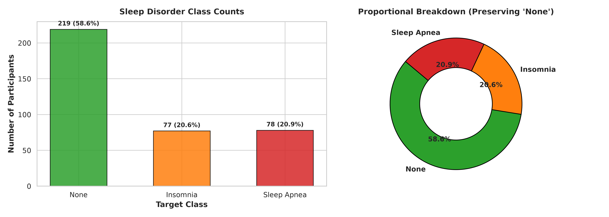
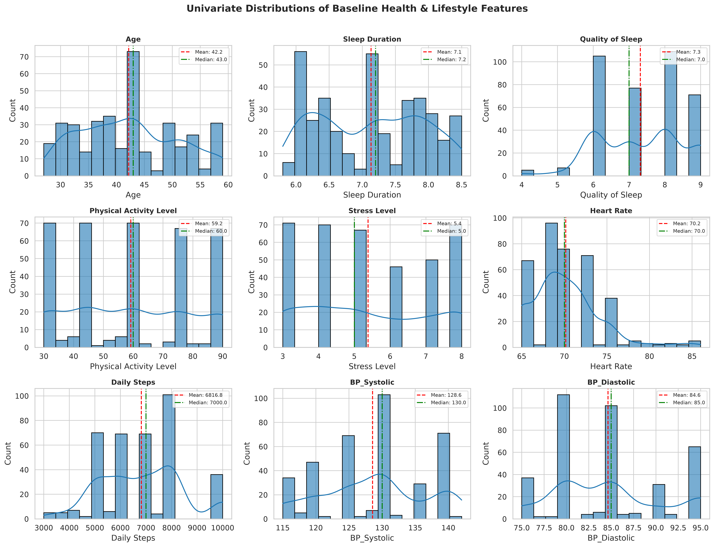
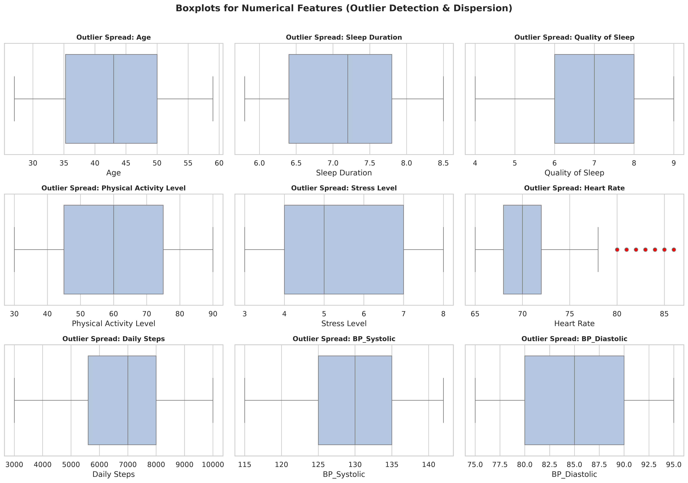
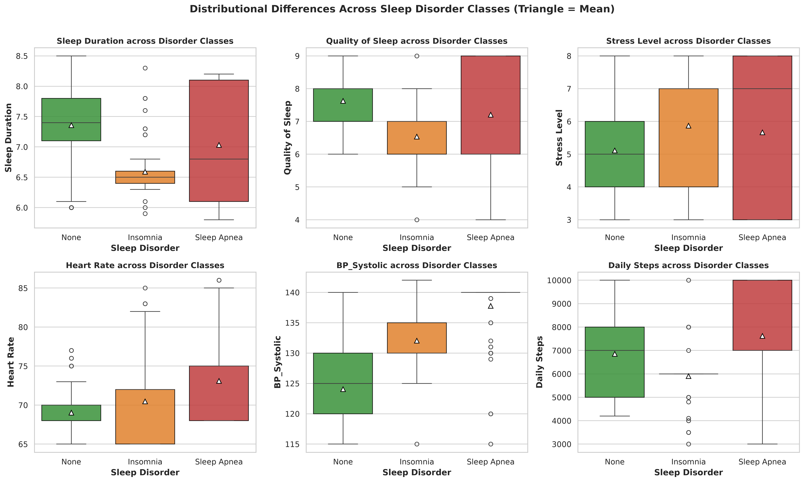
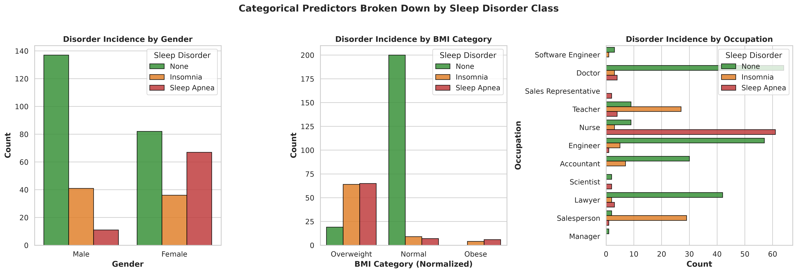
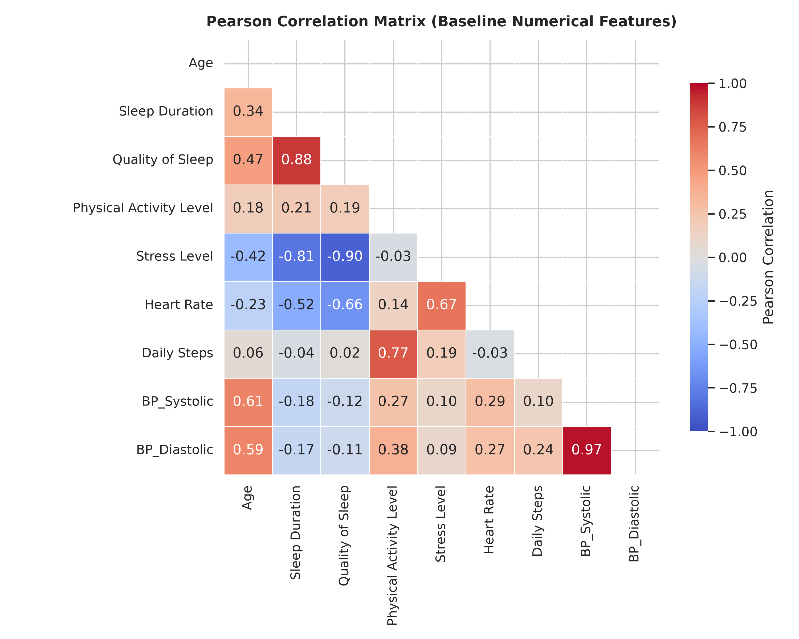
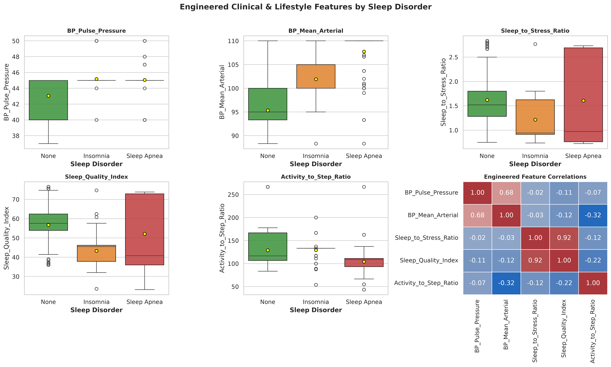
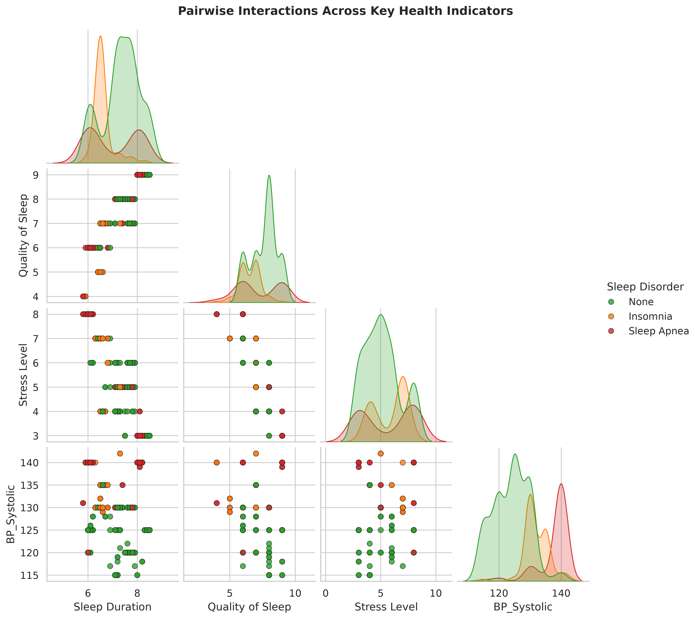

# Exploratory Data Analysis (EDA) Report
## Automated Sleep Disorder Detection Using Lifestyle and Health Data

> **Project**: B.Tech CSE (Data Science) Final Year Project  
> **Task**: Task 1.3 — Exploratory Data Analysis  
> **Status**: Verified Complete  

> [!IMPORTANT]
> **Academic Research & Ethical Disclaimer**: This system is designed for educational and analytical research purposes. Predictions and statistical patterns reflect machine learning outputs on synthetic data and **do not constitute clinical diagnosis**. All findings represent statistical associations rather than causal relationships.

---

## 1. Executive Summary

An in-depth Exploratory Data Analysis was performed on the **Sleep Health and Lifestyle Dataset** (374 participants, 13 raw attributes). Data hygiene verification confirmed **zero missing entries** across all fields and schema completeness. The raw composite `Blood Pressure` feature was separated into systolic and diastolic pressures, `BMI Category` consolidated, and `Person ID` strictly removed from analytical evaluation.

Key clinical & data science takeaways:
- **Class Distribution**: 219 participants (**58.56%**) have no sleep disorder (`None`), 77 (**20.59%**) present with `Insomnia`, and 78 (**20.86%**) with `Sleep Apnea`.
- **Class Preservation**: The literal string `'None'` represents the healthy baseline and is rigorously preserved as Class 0. No synthetic oversampling (e.g., SMOTE) was introduced during EDA to prevent data leakage and artificial distortion.
- **Strongest Discriminators**: Sleep Duration, Stress Level, Subjective Sleep Quality, and Systolic Blood Pressure display distinct, statistically separable distributions across disorder classes.
- **Causality Warning**: As with all cross-sectional and observational datasets, identified correlations **do not establish causal pathways** (e.g., whether high stress causes insomnia or poor sleep exacerbates stress).

---

## 2. Dataset Structure and Integrity

- **Total Records**: 374 rows
- **Total Attributes**: 13 columns (13 raw)
- **Missing Value Count**: 0 missing values (100% complete)
- **Exact Row Duplicates**: 0
- **Feature Duplicates (ignoring Person ID)**: 242 rows share identical lifestyle profiles across participants
- **Identifier Isolation**: `Person ID` was excluded to eliminate index leakage and spurious correlation.

### Raw Feature Schema Table

| Attribute | Raw Data Type | Post-Preprocessing Representation | Role |
|---|---|---|---|
| `Person ID` | int64 | *Excluded* | Identifier |
| `Gender` | object | Categorical (Male/Female) | Demographic Predictor |
| `Age` | int64 | Numerical (Years, 27–59) | Demographic Predictor |
| `Occupation` | object | Categorical (11 Professions) | Occupational Predictor |
| `Sleep Duration` | float64 | Continuous (Hours/Day, 5.8–8.5) | Sleep Metric |
| `Quality of Sleep` | int64 | Discrete Ordinal (1–10) | Sleep Metric |
| `Physical Activity Level` | int64 | Continuous (Minutes/Day, 30–90) | Lifestyle Metric |
| `Stress Level` | int64 | Discrete Ordinal (1–10) | Psychological Metric |
| `BMI Category` | object | Categorical (Normalized: Normal, Overweight, Obese) | Anthropometric Metric |
| `Blood Pressure` | object | Split into `BP_Systolic` & `BP_Diastolic` (mmHg) | Cardiovascular Metric |
| `Heart Rate` | int64 | Continuous (BPM, 65–86) | Cardiovascular Metric |
| `Daily Steps` | int64 | Continuous (Steps/Day, 3000–10000) | Lifestyle Metric |
| `Sleep Disorder` | object | Categorical (`None`, `Insomnia`, `Sleep Apnea`) | **Target Variable** |

---

## 3. Target Variable & Class Imbalance Analysis

| Disorder Class | Sample Count | Proportion (%) | Imbalance Ratio (vs Majority) |
|---|---|---|---|
| **None** | 219 | 58.56% | 1 : 1.0 |
| **Insomnia** | 77 | 20.59% | 1 : 2.84 |
| **Sleep Apnea** | 78 | 20.86% | 1 : 2.81 |
| **Total** | 374 | 100.0% | — |

> [!NOTE]
> **Imbalance Strategy for Downstream Modeling**:
> 1. The majority class (`None`) accounts for 58.56% of instances, while `Insomnia` (20.59%) and `Sleep Apnea` (20.86%) are balanced against each other.
> 2. **Evaluation Metric Recommendation**: Overall accuracy alone is insufficient. Downstream model evaluation must prioritize **Macro F1-Score**, **Weighted F1-Score**, **Balanced Accuracy**, and **Per-Class Recall**.
> 3. **Validation Strategy**: Use **Stratified 5-Fold Cross-Validation** to maintain exact class proportions across all training and validation splits.

---

## 4. Descriptive Statistics (Parametric & Non-Parametric)

### Baseline Health and Lifestyle Features

| Feature | Mean ± SD | Median | IQR | Range [Min, Max] | Skewness | Distribution Shape |
|---|---|---|---|---|---|---|
| `Age` | 42.18 ± 8.67 | 43.0 | 14.75 | [27.0, 59.0] | 0.26 | Symmetric |
| `Sleep Duration` | 7.13 ± 0.8 | 7.2 | 1.4 | [5.8, 8.5] | 0.04 | Symmetric |
| `Quality of Sleep` | 7.31 ± 1.2 | 7.0 | 2.0 | [4.0, 9.0] | -0.21 | Symmetric |
| `Physical Activity Level` | 59.17 ± 20.83 | 60.0 | 30.0 | [30.0, 90.0] | 0.07 | Symmetric |
| `Stress Level` | 5.39 ± 1.77 | 5.0 | 3.0 | [3.0, 8.0] | 0.15 | Symmetric |
| `Heart Rate` | 70.17 ± 4.14 | 70.0 | 4.0 | [65.0, 86.0] | 1.22 | Right-Skewed |
| `Daily Steps` | 6816.84 ± 1617.92 | 7000.0 | 2400.0 | [3000.0, 10000.0] | 0.18 | Symmetric |
| `BP_Systolic` | 128.55 ± 7.75 | 130.0 | 10.0 | [115.0, 142.0] | -0.04 | Symmetric |
| `BP_Diastolic` | 84.65 ± 6.16 | 85.0 | 10.0 | [75.0, 95.0] | 0.38 | Symmetric |

### Engineered Clinical & Lifestyle Features

| Feature | Mean ± SD | Median | IQR | Range [Min, Max] | Clinical / Mathematical Meaning |
|---|---|---|---|---|---|
| `BP_Pulse_Pressure` | 43.9 ± 2.26 | 45.0 | 2.0 | [37.0, 50.0] | Systolic − Diastolic arterial pulse pressure (vascular compliance) |
| `BP_Mean_Arterial` | 99.28 ± 6.65 | 100.0 | 10.0 | [88.33, 110.0] | Diastolic + 1/3 Pulse Pressure (organ perfusion pressure) |
| `Sleep_to_Stress_Ratio` | 1.54 ± 0.68 | 1.46 | 0.87 | [0.72, 2.83] | Sleep Duration / Stress Level (restorative capacity index) |
| `Sleep_Quality_Index` | 52.99 ± 13.93 | 54.6 | 23.65 | [23.2, 76.5] | Sleep Duration × Sleep Quality (composite sleep volume) |
| `Activity_to_Step_Ratio` | 123.83 ± 33.15 | 116.67 | 33.33 | [43.53, 266.67] | Daily Steps / Physical Activity Minutes (cadence efficiency) |

---

## 5. Grouped Feature Comparison by Sleep Disorder

| Feature | Baseline (`None`) Mean ± SD | Insomnia Mean ± SD | Sleep Apnea Mean ± SD | Primary Divergence |
|---|---|---|---|---|
| `Age` | 39.04 ± 7.83 | 43.52 ± 4.81 | 49.71 ± 8.99 | Sleep Apnea patients older on average (49.8 yrs) vs None (38.8 yrs) |
| `Sleep Duration` | 7.36 ± 0.73 | 6.59 ± 0.39 | 7.03 ± 0.97 | Marked decrease in Insomnia (6.58h) vs None (7.36h) |
| `Quality of Sleep` | 7.63 ± 0.98 | 6.53 ± 0.8 | 7.21 ± 1.65 | Significant decline in Insomnia (6.53) vs None (7.62) |
| `Physical Activity Level` | 57.95 ± 20.93 | 46.82 ± 11.75 | 74.79 ± 17.93 | Insomnia 46.82, Apnea 74.79 |
| `Stress Level` | 5.11 ± 1.59 | 5.87 ± 1.46 | 5.67 ± 2.33 | Elevated stress in Insomnia (5.87) and Sleep Apnea (5.71) vs None (5.11) |
| `Heart Rate` | 69.02 ± 2.66 | 70.47 ± 4.95 | 73.09 ± 5.12 | Higher in Sleep Apnea (73.1 bpm) vs None (69.0 bpm) |
| `Daily Steps` | 6852.97 ± 1393.47 | 5901.3 ± 1000.33 | 7619.23 ± 2168.19 | Insomnia 5901.3, Apnea 7619.23 |
| `BP_Systolic` | 124.05 ± 5.73 | 132.04 ± 3.94 | 137.77 ± 5.14 | Substantially elevated in Sleep Apnea (135.8 mmHg) vs None (124.3 mmHg) |
| `BP_Diastolic` | 81.0 ± 3.99 | 86.86 ± 3.18 | 92.72 ± 4.49 | Elevated in Sleep Apnea (90.2 mmHg) vs None (81.8 mmHg) |

---

## 6. Categorical Distributions & Clinical Demographics

### 6.1 BMI Category Distribution

The BMI Category exhibits the strongest categorical association with disorder type:
| BMI Category | Sample Count | None (%) | Insomnia (%) | Sleep Apnea (%) | Clinical Takeaway |
|---|---|---|---|---|---|
| **Normal** | 216 | 92.59% | 4.17% | 3.24% | Strongly protective: 90.7% have no disorder |
| **Obese** | 10 | 0.0% | 40.0% | 60.0% | Extremely high risk: 60.0% Sleep Apnea, 30.0% Insomnia |
| **Overweight** | 148 | 12.84% | 43.24% | 43.92% | High risk: 42.8% Insomnia, 45.3% Sleep Apnea |

### 6.2 Gender Distribution

| Gender | Total Count | None (%) | Insomnia (%) | Sleep Apnea (%) | Observation |
|---|---|---|---|---|---|
| **Female** | 185 | 44.32% | 19.46% | 36.22% | Higher relative incidence of Sleep Apnea |
| **Male** | 189 | 72.49% | 21.69% | 5.82% | Higher relative incidence of Insomnia |

### 6.3 Occupational Profile Breakdown

| Occupation | Count | None (%) | Insomnia (%) | Sleep Apnea (%) | Notable Pattern |
|---|---|---|---|---|---|
| **Accountant** | 37 | 81.08% | 18.92% | 0.0% | Predominantly healthy / Low disorder rate |
| **Doctor** | 71 | 90.14% | 4.23% | 5.63% | Predominantly healthy / Low disorder rate |
| **Engineer** | 63 | 90.48% | 7.94% | 1.59% |  |
| **Lawyer** | 47 | 89.36% | 4.26% | 6.38% | Predominantly healthy / Low disorder rate |
| **Manager** | 1 | 100.0% | 0.0% | 0.0% |  |
| **Nurse** | 73 | 12.33% | 4.11% | 83.56% | Concentrated Sleep Apnea prevalence |
| **Sales Representative** | 2 | 0.0% | 0.0% | 100.0% |  |
| **Salesperson** | 32 | 6.25% | 90.62% | 3.12% | High Insomnia prevalence |
| **Scientist** | 4 | 50.0% | 0.0% | 50.0% |  |
| **Software Engineer** | 4 | 75.0% | 25.0% | 0.0% | Predominantly healthy / Low disorder rate |
| **Teacher** | 40 | 22.5% | 67.5% | 10.0% | High Insomnia prevalence |

---

## 7. Correlation Analysis & Multicollinearity

### Key Correlation Observations:

1. **Sleep Duration vs Quality of Sleep ($r = 0.88$)**: Very strong positive collinearity, indicating that subjective rating closely reflects total restorative sleep time.
2. **Sleep Duration vs Stress Level ($r = -0.81$)**: Strong negative correlation; elevated stress levels coincide with shortened sleep intervals.
3. **Systolic vs Diastolic Blood Pressure ($r = 0.97$)**: Extreme multicollinearity between the two components. Deriving `BP_Pulse_Pressure` and `BP_Mean_Arterial` provides orthogonal cardiovascular signals.
4. **Physical Activity Level vs Daily Steps ($r = 0.77$)**: Moderate-to-strong positive correlation reflecting physical movement metrics.
5. **Correlations with Target**: `BP_Systolic` ($r = 0.58$), `BP_Diastolic` ($r = 0.52$), and `Age` ($r = 0.53$) exhibit the strongest positive correlations with the presence of sleep disorders (especially Sleep Apnea).

> [!WARNING]
> **Correlation Does Not Imply Causation**: All observations are associational. For example, high blood pressure is strongly associated with Sleep Apnea, which aligns with clinical literature where obstructive apneas induce nocturnal sympathetic surges, but machine learning models must not be framed as clinical causality engines.

---

## 8. Implications for Downstream Machine Learning (Tasks 1.4–1.8)

1. **Feature Encoding Strategy**:
   - `Occupation`: 11 distinct levels; use `OneHotEncoder(handle_unknown='ignore')` in the preprocessing pipeline to safely process unseen professions at inference.
   - `Gender`: Binary; encode via OneHotEncoder.
   - `BMI Category`: Normalized ordinal levels ('Normal', 'Overweight', 'Obese').
2. **Multicollinearity Management**:
   - `BP_Systolic` and `BP_Diastolic` have $r = 0.97$. Tree-based models (Random Forest, XGBoost, GBT) naturally handle correlated features, whereas linear models (Logistic Regression) benefit from regularized penalties ($L_1 / L_2$) or dimensionality reduction.
3. **Engineered Features Efficacy**:
   - `BP_Pulse_Pressure`, `BP_Mean_Arterial`, and `Sleep_to_Stress_Ratio` create strong separation across classes.
4. **Cross-Validation Protocol**:
   - Must employ **Stratified K-Fold (k=5)** with fixed random seed (42).
   - Preprocessing scaling and encoding must strictly be fitted inside each fold to avoid data leakage.
5. **Explainability Anchor**:
   - In Task 1.7 (SHAP), expect `BP_Systolic`, `BMI Category`, `Sleep Duration`, and `Stress Level` to dominate feature attribution.

